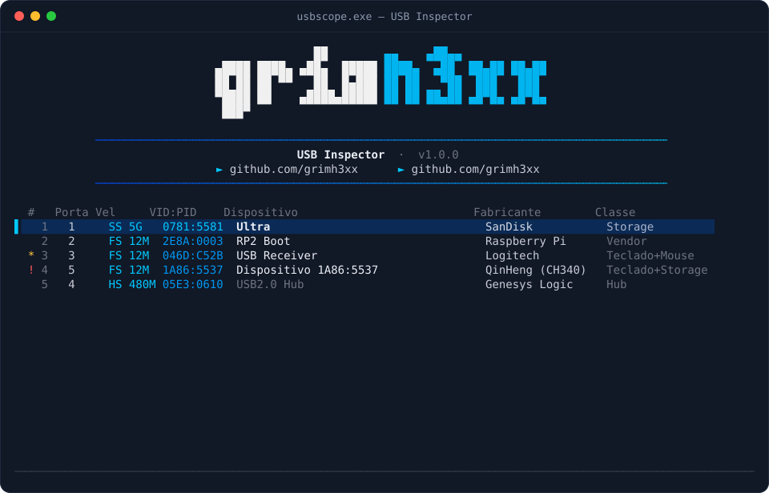

<div align="center">


**Inspetor de dispositivos USB interativo para o terminal do Windows**
feito com WinUSB / IOCTLs de hub · C++17 · sem dependências externas

[](https://github.com/grimh3xx/usbscope/actions)
[](https://github.com/grimh3xx/usbscope/releases/latest)
[](LICENSE)


`grimh3xx` · [github.com/grimh3xx](https://github.com/grimh3xx) · [github.com/grimh3xx](https://github.com/grimh3xx)

</div>

<p align="center"></p>


---

Lista todos os dispositivos USB conectados, lê os **descritores de cada um direto do driver do hub** (mesmo os que têm driver próprio, como teclados e pendrives) e mostra tudo numa interface TUI navegável — com a logo da grimh3xx em pixel art no topo, igual ao `samcli`.

## O que ele faz

- **Enumera tudo** — caminha por cada controlador e hub (inclusive hubs aninhados) via `IOCTL_USB_GET_NODE_CONNECTION_INFORMATION_EX`, do mesmo jeito que o *USBView* da Microsoft. Não precisa instalar driver nenhum.
- **Descritores completos** — device, configuration, interfaces, endpoints e strings (manufacturer/product/serial), decodificados e em **hex cru** lado a lado.
- **Reconhece classes** — HID (teclado/mouse), armazenamento em massa (BOT/UAS), CDC-ACM (serial), DFU, hub, áudio, vídeo, vendor-specific e mais.
- **Base de VID:PID embutida** (+ `usb.ids` opcional) pra mostrar o nome do fabricante mesmo quando o dispositivo não traz strings.
- **Observações de segurança** — aponta combinações incomuns (ex.: teclado HID junto de armazenamento), interfaces DFU/serial expostas, ausência de número de série etc. São dicas pra inspeção manual, não um veredito.

## Interface

| Tela | Teclas |
|------|--------|
| **Lista** | `↑ ↓` mover · `↵` abrir · `/` filtrar · `c` limpar filtro · `r` atualizar · `q` sair |
| **Detalhes** | `← → / Tab` trocar de aba (visão geral · hex device · hex config) · `↑ ↓` rolar · `Esc` voltar |

A coluna da esquerda marca com `!` (vermelho) ou `*` (amarelo) os dispositivos com observações de segurança.

## Compilar

**Windows (recomendado):** é só rodar o script — ele acha o MSVC ou o MinGW sozinho.

```bat
build.bat
```

- **MSVC:** abra o *x64 Native Tools Command Prompt for VS* e rode `build.bat`.
- **MinGW (MSYS2):** `pacman -S mingw-w64-x86_64-gcc`, depois `build.bat` (ou `mingw32-make`).

Gera um `usbscope.exe` estático, sem DLLs extras. Bibliotecas usadas: `setupapi`, `cfgmgr32` (ambas já vêm no Windows).

**Desenvolvimento da UI em qualquer SO** (dados simulados, sem hardware):

```sh
make test       # testes dos parsers de descritor
make test-ui    # compila a prévia da UI; use USBSCOPE_KEYS=... pra navegar
```

> Requer um terminal com suporte a *virtual terminal sequences* — **Windows Terminal** (recomendado, habilita links clicáveis e cores 24-bit) ou o `conhost` do Windows 10 1703+.

## `usb.ids` (opcional)

Para nomes de fabricante/produto mais completos, coloque o arquivo [`usb.ids`](http://www.linux-usb.org/usb.ids) ao lado do `usbscope.exe`. Sem ele, vale a tabela embutida com os VIDs mais comuns (incluindo várias placas de hardware hacking: FTDI, CH340, CP210x, RP2040, STM32 DFU, HackRF, Ubertooth, J-Link…).

## Estrutura

```
src/
  app.cpp          loop da TUI, lista e telas de detalhe
  banner.*         logo grimh3xx em pixel art (meio-blocos + cor 24-bit)
  term.hpp
  term_win.cpp     console do Windows: VT, UTF-8, teclas, tela alternativa
  usbenum.hpp
  usbenum_win.cpp  enumeração via SetupAPI + IOCTLs de hub
  usbenum_mock.cpp dispositivos simulados pra desenvolver a UI fora do Windows
  usbdesc.*        parser dos descritores + heurísticas de segurança
  usbids.*         base VID:PID (embutida + usb.ids)
  device.*         modelo de um dispositivo
  textutil.*       cor ANSI, largura de UTF-8, hex dump
tools/
  gen_banner.py    gera o banner_data.inc a partir da logo
tests/
  test_portable.cpp
```

## Aviso

Ferramenta de **inspeção e diagnóstico**. As observações de segurança são heurísticas para apoiar análise manual — um dispositivo marcado não é necessariamente malicioso, nem a ausência de marca garante que seja seguro.

---

<div align="center">
<sub>© grimh3xx — <a href="https://github.com/grimh3xx">github.com/grimh3xx</a></sub>
</div>
